# Comprehensive System Audit & Improvement Roadmap: KeyboardWriterHelper

> **Executive Overview**  
> Following an exhaustive, line-by-line audit of the entire codebase (comprising 3 deep-audit review tracks across Engine, Hook, Interop, Spelling, Ranking, Configuration, UI, Lifecycle, Build, and Test coverage), this document catalogs all identified flaws, blind spots, and architectural risks, categorized by severity with actionable remediation designs.

---

## Issue Summary Matrix

| Subsystem | Critical | High | Medium | Low | Total |
| :--- | :---: | :---: | :---: | :---: | :---: |
| **1. Hook & Win32 Interop** (`Corrector.cs`, `Native.cs`) | 2 | 3 | 4 | 2 | **11** |
| **2. Engine & State Machine** (`Engine.cs`) | 1 | 3 | 4 | 3 | **11** |
| **3. Spelling & Candidate Ranking** (`WindowsDictionary.cs`, `Ranker.cs`, `Speller.cs`) | 3 | 5 | 8 | 5 | **21** |
| **4. Configuration & Persistence** (`Settings.cs`, `Data.cs`) | 1 | 2 | 3 | 3 | **9** |
| **5. UI & Application Lifecycle** (`TrayApp.cs`, `SettingsForm.cs`, `CandidatePopup.cs`) | 1 | 4 | 4 | 3 | **12** |
| **6. Build, Test Harness & Phrase Coverage** (`build.cmd`, `test.cmd`, test suites) | 1 | 2 | 3 | 3 | **9** |
| **TOTAL** | **9** | **19** | **26** | **19** | **73** |

---

## 1. Critical Flaws & Crashes (P0 — Immediate Remediation Required)

### [CRIT-01] Smart Typography Breaks Phrase Tracking & Causes Text Corruption
- **Location**: `src/Engine/Engine.cs:304-398`
- **Blind Spot**: When smart typography converts symbols (e.g. `-- ` to `— `, `... ` to `… `, `-> ` to `→ `), it emits replacement backspaces and updates the screen, but **never updates `previous`, `secondPrevious`, or `thirdPrevious`**.
- **Impact**: The multi-word phrase state machine retains stale words from before the symbol substitution. If a user types `could of been` or any multi-word phrase after a dash or ellipsis, the engine calculates backspaces based on mismatched offsets, deleting arbitrary user text and inserting corrupted strings.
- **Fix**: Update `previous`, `secondPrevious`, `thirdPrevious = null` or register the emitted symbol as the current token delimiter.

### [CRIT-02] Synchronous 100ms Hook Timeout Risks Silent Hook Removal by Windows
- **Location**: `src/Hook/Corrector.cs:361` & `src/Spelling/Speller.cs:385`
- **Blind Spot**: In the low-level keyboard hook callback (`LowLevelKeyboardProc`), the thread synchronously waits up to 100ms (`request.Done.WaitOne(budgetMs)`). Windows monitors `WH_KEYBOARD_LL` callbacks with `LowLevelHooksTimeout` (typically 200ms–300ms, and as low as 100ms under registry policy or high load). If GC pauses or worker thread contention push latency past the threshold, **Windows silently unhooks the application without notifying the process**.
- **Impact**: The app remains running in the tray, but key correction stops working completely with no error message.
- **Fix**: Introduce asynchronous candidate pre-fetching during typing, or decouple key swallowing from dictionary lookup via speculative backspace queuing.

### [CRIT-03] Synchronous Clipboard Interop Blocks Hook Thread Indefinitely
- **Location**: `src/Interop/Native.cs:270-305` & `src/Engine/Engine.cs:964`
- **Blind Spot**: Expanding `{clip}` in dynamic snippets calls `Native.GetClipboardText()` directly from the keyboard hook execution thread. `OpenClipboard` and `GetClipboardData(CF_UNICODETEXT)` perform synchronous RPC to the clipboard owner process. If the clipboard owner uses delayed rendering (e.g. Excel, Photoshop, VM clients) and is unresponsive, the keyboard hook thread deadlocks.
- **Impact**: The entire Windows UI locks up because keyboard input messages cannot be pumped through the system hook chain.
- **Fix**: Cache clipboard text on clipboard update notifications (`AddClipboardFormatListener`), or read clipboard text asynchronously on a background thread with a strict 20ms timeout.

### [CRIT-04] Kernel Handle Leak on Every Keystroke via `ManualResetEvent`
- **Location**: `src/Spelling/Speller.cs:198, 379`
- **Blind Spot**: `Request` instantiates `public readonly ManualResetEvent Done = new ManualResetEvent(false);`. For every single word evaluated, a new Win32 Kernel Event `HANDLE` is allocated. Neither `Suggest`, `Work`, nor `Configure` ever calls `request.Done.Dispose()` or `Close()`.
- **Impact**: Typing a few thousand words leaks thousands of unmanaged OS handles, inflating system handle tables and causing memory degradation and finalizer thread contention.
- **Fix**: Reuse a thread-local or pooled `ManualResetEvent` / `ManualResetEventSlim`, or ensure `request.Done.Dispose()` is called in a `finally` block in `Suggest()`.

### [CRIT-05] `IndexOutOfRangeException` Crash on Empty Candidate in `Ranker.Cost`
- **Location**: `src/Spelling/Ranker.cs:834` (in `Cost`) & `Best:418`
- **Blind Spot**: `Cost` accesses `a[0]` and `b[0]` unconditionally: `if (a[0] != b[0] ...)`. In `Best`, only `lower.Length > MaxLength` is guarded; `lower.Length == 0` is never checked.
- **Impact**: If an empty string or token consisting solely of stripped punctuation reaches `Best`, the app throws an unhandled `IndexOutOfRangeException` and crashes.
- **Fix**: Add `if (string.IsNullOrEmpty(lower) || lower.Length > MaxLength) return null;` at the entry of `Best`, and add guard clauses `if (n == 0 || m == 0) return Math.Max(n, m);` in `Cost`.

### [CRIT-06] Total Capitalization Failure for Short Words (e.g. "i" -> "I", "mon" -> "Mon")
- **Location**: `src/Spelling/Ranker.cs:469`
- **Blind Spot**: In `Best`:
  ```csharp
  if (all.Count > 0 && all[0].Cost == 0)
      return lower.Length > ShortWord ? all[0].Word : null;
  ```
  Where `ShortWord = 3`.
- **Impact**: Any word of length 1, 2, or 3 requiring only capitalization is **unconditionally rejected**. Typing lowercase `"i"` is *never* capitalized to `"I"`, nor is `"mon"` -> `"Mon"`, `"god"` -> `"God"`, or `"usa"` -> `"USA"`.
- **Fix**: Change condition to permit single-letter pronouns (`lower == "i"`) and known acronyms/proper nouns regardless of length when `Cost == 0`.

### [CRIT-07] Non-Atomic File Writes & Silent Data Loss on Settings/Lists
- **Location**: `src/Configuration/Settings.cs:251, 532, 754`
- **Blind Spot**: `Settings.Save()`, `ListFile.Sync()`, and `TypoLog.Save()` directly overwrite disk files in place using `File.WriteAllText`. In `ListFile.Sync()` and `TypoLog.Save()`, `unsaved = false;` is set **before** the write operation inside a `try ... catch (IOException) { }`.
- **Impact**: If a file sharing conflict occurs (e.g. antivirus scanner, cloud backup, open in Notepad), the write fails silently, but `unsaved` remains `false`. Changes are permanently dropped. If a crash or power cut occurs during `WriteAllText`, the configuration file is left truncated to 0 bytes.
- **Fix**: Write to a temporary file (`.tmp`), flush to disk, and perform an atomic replacement via `File.Replace()` or `MoveFileEx(MOVEFILE_REPLACE_EXISTING)`. Only clear `unsaved` upon confirmed write.

### [CRIT-08] Fatal Win32Exception in `SettingsForm` on .NET 9
- **Location**: `src/UI/SettingsForm.cs:684`
- **Blind Spot**: The "Open the data folder" link invokes `Process.Start(app.DataFolder)`. In .NET Core / .NET 9+, `ProcessStartInfo.UseShellExecute` defaults to `false` (unlike .NET Framework 4.0 where it was `true`).
- **Impact**: On modern .NET 9 builds, clicking this link throws `System.ComponentModel.Win32Exception: The specified executable is not a valid application for this OS platform` and crashes the UI.
- **Fix**: Use `Process.Start(new ProcessStartInfo { FileName = app.DataFolder, UseShellExecute = true })`.

### [CRIT-09] Masked Exit Codes in `test.cmd` Hide Test Failures
- **Location**: `test.cmd:38, 43, 48`
- **Blind Spot**: Test commands pipe output into `findstr "^"` to capture asynchronous console output:
  ```cmd
  %EXE% --cases tests\typing-cases.txt | findstr "^"
  if errorlevel 1 goto failed
  ```
  In Windows Command Prompt (`cmd.exe`), `%ERRORLEVEL%` reflects the **last command in the pipeline** (`findstr`), NOT `%EXE%`.
- **Impact**: If the test suite fails (exit code 1 or 2), `findstr` exits with code 0 because it matched lines, causing `test.cmd` to falsely report all tests passed.
- **Fix**: Redirect output to a temporary log file without piping, check `if errorlevel 1`, and then type the log file to console.

---

## 2. High Priority Architectural & Reliability Flaws (P1)

### [HIGH-01] COM Native Leaks in Windows Spell Checker [RESOLVED]
- **Location**: `src/Spelling/WindowsDictionary.cs`, `src/Spelling/Speller.cs`, `src/UI/TrayApp.cs`
- **Problem**: `ISpellCheckerFactory` is instantiated via RCW without `Marshal.ReleaseComObject`. `WindowsDictionary` does not implement `IDisposable`, leaving all native `ISpellChecker` instances orphaned upon language changes or dictionary reloads.
- **Impact**: Native heap memory leaks and locked registry/lexicon handles during long-running sessions.
- **Fix**: Implement `IDisposable` on `WindowsDictionary`, `Speller`, and `SpellService`; explicitly invoke `Marshal.ReleaseComObject` in reverse instantiation order and dispose instances on shutdown and reconfiguration.

### [HIGH-02] Dead Code: Keyboard Layout Auto-Detection Never Runs [RESOLVED]
- **Location**: `src/Spelling/Ranker.cs` & `src/Hook/Corrector.cs` & `src/Spelling/Speller.cs`
- **Problem**: `Ranker.DetectLayout(IntPtr hkl)` was authored to recognize QWERTZ, AZERTY, Dvorak, and Colemak from active keyboard layouts, but was never invoked.
- **Impact**: The advertised multi-layout typing proximity feature was non-functional; QWERTY adjacency was always used unless manually forced by user settings.
- **Fix**: In `Corrector.cs`, read the foreground window's keyboard layout handle via `Native.GetKeyboardLayout` and forward it via `SpellService.UpdateLayout(layout)` to `Ranker.UpdateActiveLayout(layout)`.

### [HIGH-03] Single-Character Substitution Typos in Short Words Always Rejected [RESOLVED]
- **Location**: `src/Spelling/Ranker.cs` & `src/Engine/Engine.cs`
- **Problem**: Words with length <= 3 trigger `cautious = true`. With `CautiousMaxCost = 0.6`, single vowel swaps (0.7) and nearby key swaps (0.8) were mathematically rejected in short words.
- **Impact**: Single-letter typos in 2- or 3-letter words were rejected (`kat` -> `cat`, `dof` -> `dog`).
- **Fix**: Refine cautious threshold to accept high-confidence proximity and vowel substitutions (`Cost <= 0.85`) when the target word is common (`commonness >= 5.0`) and the typed token is a rare typo.

### [HIGH-04] Fullscreen Game Detection False Positives on Maximized Borderless Windows [RESOLVED]
- **Location**: `src/Interop/Native.cs`
- **Problem**: `IsForegroundFullScreen` checks if the foreground window bounds match or exceed the screen bounds and lacks `WS_CAPTION`. However, borderless maximized applications (Chrome, Edge, Slack, VS Code with custom titlebars) match these exact bounds and style bits when maximized.
- **Impact**: KeyboardWriterHelper arbitrarily disables itself in normal productivity applications, mistaking them for fullscreen 3D games.
- **Fix**: Query `GetWindowLong(fg, GWL_STYLE)` for `WS_MAXIMIZE`. If `WS_MAXIMIZE` is set, the window is a maximized standard application, not a fullscreen exclusive game.

### [HIGH-05] AltGr Key on European Keyboards Wipes Typing State [RESOLVED]
- **Location**: `src/Hook/Corrector.cs` & `src/Interop/Native.cs`
- **Problem**: On German, French, Spanish, and Polish layouts, AltGr is sent by Windows as `VK_LCONTROL` followed by `VK_RMENU` (`Ctrl + Alt`). When `Corrector` sees `Ctrl` or `Alt` pressed without a printable character, it calls `engine.Break(false)`.
- **Impact**: Typing common characters via AltGr (e.g. `@`, `\`, `[`, `]`, `~`, `€`) wipes the word in progress, preventing any corrections on adjacent words.
- **Fix**: Distinguish between standalone control shortcuts and the AltGr modifier sequence (`IsDown(VK_RMENU)`). Populate AltGr modifiers into `keyState` for `ToUnicodeEx` translation.

### [HIGH-06] SendInput UIPI Silent Dropping Against Elevated Windows [RESOLVED]
- **Location**: `src/Interop/Native.cs` & `src/Hook/Corrector.cs`
- **Problem**: When typing into an administrator command prompt, PowerShell, Task Manager, or regedit while KeyboardWriterHelper runs unelevated, Windows User Interface Privilege Isolation (UIPI) blocks injected inputs from `SendInput`. `SendInput` returns 0, which is ignored.
- **Impact**: The app deletes characters or fails to type fixes, leaving the target editor in a corrupted state.
- **Fix**: Inspect the return value of `SendInput`. If `Send` returns false (access denied or 0 events sent), add the window to `uipiBlocked` cache and break the engine safely.

### [HIGH-07] GDI HICON Handle Leak & Zombie Tray Icons [RESOLVED]
- **Location**: `src/UI/TrayApp.cs`
- **Problem**: `MakeIcon` calls `bmp.GetHicon()` to generate `Icon` instances. `GetHicon` creates unmanaged native GDI icon handles. Calling `icon.Dispose()` does NOT destroy the underlying GDI handle (`DestroyIcon` P/Invoke is required). Additionally, `TrayApp` lacks handlers for `AppDomain.UnhandledException`, `Application.ThreadException`, or `ProcessExit`.
- **Impact**: If the app is killed or encounters an error, the icon remains in the notification area as a "ghost" until moused over, and GDI handle quotas leak during reloads.
- **Fix**: P/Invoke `DestroyIcon` after cloning managed icon in `MakeIcon`, and attach cleanup routines to `Application.ApplicationExit`, `AppDomain.CurrentDomain.UnhandledException`, and `AppDomain.CurrentDomain.ProcessExit`.

### [HIGH-08] SettingsForm Timer Wipes User Selection & Overwrites Disk Edits [RESOLVED]
- **Location**: `src/UI/SettingsForm.cs:822-838` & `src/Configuration/Settings.cs:538`
- **Problem**: The 1-second refresh timer calls `list.Items.Clear()` whenever collection counts change, deselecting the user's active item while they are trying to click "Remove" or review typos. Furthermore, if a user edits wordlists in Notepad while `SettingsForm` is open, any subsequent save from the UI overwrites Notepad's disk changes.
- **Impact**: Deselects user selections mid-interaction and risks data loss on external file edits.
- **Fix**: Perform differential updates on `ListBox.Items` without clearing unchanged lists, preserve `SelectedIndex`, and check file write timestamps prior to saving.

### [HIGH-09] Floating Candidate Popup Has No Caret Tracking [RESOLVED]
- **Location**: `src/UI/CandidatePopup.cs:115-155`
- **Problem**: The popup does not query Win32 `GetGUIThreadInfo` or UI Automation caret position; it merely checks the foreground window's outer rectangle and positions itself at an offset. On multi-monitor setups with negative coordinates, or when editors are anchored to the bottom/right of screens, the popup renders completely off-screen or covers the text being typed.
- **Impact**: Candidates popup renders in wrong screen locations or off-screen.
- **Fix**: Query `GetGUIThreadInfo` to locate the true text insertion caret `rcCaret`. Fall back to cursor position or window bounds only if caret info is inaccessible. Implement per-monitor DPI scaling.

---

## 3. Engine, Spelling & Grammar Coverage Blind Spots (P2)

### [MED-01] Destructive Normalization in `American()` Suppresses Valid Words [RESOLVED]
- **Location**: `src/Spelling/Ranker.cs`
- **Problem**: `American()` previously used blind substring replacements across the entire token (`"our" -> "or"`, `"ll" -> "l"`, `"ence" -> "ense"`), falsely treating words like `four` and `for`, `really` and `realy`, `fence` and `fense` as variants.
- **Impact**: Suppressed valid corrections and caused erroneous substitutions.
- **Fix**: Restrict American/British transformations to word-suffix checks (e.g. `EndsWith("our")` for length > 4, `-ogue`, `-tre/-bre`) and specific variant pairs rather than unbounded replacements.

### [MED-02] Foreign Diacritics & Accented Vowels Misclassified [RESOLVED]
- **Location**: `src/Spelling/Ranker.cs`
- **Problem**: `IsVowel(char c)` only checked ASCII vowels, causing accented loanwords common in English (`café`, `résumé`, `cliché`, `façade`, `naïve`) to suffer heavy consonant penalties.
- **Impact**: Accented words were penalized in ranking.
- **Fix**: Include accented vowels in `IsVowel` and add `BaseChar(c)` to provide cheap `0.2` swap cost for diacritic accent corrections.

### [MED-03] Major High-Frequency Homophone Gaps in Phrase Fixes [RESOLVED]
- **Location**: `data/phrase-fixes.txt`
- **Problem**: The phrase-fix dictionary has minimal coverage for the most frequent grammatical mistakes in English typing:
  - `they're / their / there`: `there going` -> `they're going`, `their is` -> `there is`, `put it over their` -> `put it over there`.
  - `you're / your`: `your welcome` -> `you're welcome`, `your right` -> `you're right`, `you're car` -> `your car`.
  - `it's / its`: `its ok` -> `it's ok`, `it's wings` -> `its wings`.
  - `than / then`: `better then` -> `better than`, `more then` -> `more than`, `and than` -> `and then`.
  - `too / to`: `to much` -> `too much`, `to many` -> `too many`, `me to` -> `me too`.
  - `lose / loose`: `loose weight` -> `lose weight`, `lose knot` -> `loose knot`.
- **Fix**: Expand `data/phrase-fixes.txt` with these unambiguous 2-word and 3-word grammatical patterns.

### [MED-04] Smart Quotes Break Word Boundaries [RESOLVED]
- **Location**: `src/Engine/Engine.cs` & `src/Spelling/Ranker.cs`
- **Problem**: Microsoft Word, Outlook, and web browsers automatically replace ASCII apostrophes `'` with typographic right single quotes `’` (`\u2019`).
- **Impact**: The engine treated `\u2019` as a foreign character / punctuation break, splitting contractions like `don’t` into `don` and `t`.
- **Fix**: Normalize curly single quotes (`\u2018`, `\u2019`) to ASCII `'` in `Engine.Char` and `Ranker.Best`.

### [MED-05] TypoLog Memory Leak Under Continuous Unique Misspellings [RESOLVED]
- **Location**: `src/Configuration/Settings.cs:686-688`
- **Problem**: When `counts.Count > MaxEntries`, `TypoLog` purges items with count == 1. Once all items in the dictionary have a count >= 2, the purge removes 0 items.
- **Impact**: In long sessions, the dictionary grows indefinitely, and `new List<string>(counts.Keys)` is allocated inside `lock (gate)` on every single correction on the keyboard hook thread.
- **Fix**: Evict the oldest or least-frequently used (LFU) entries when `counts.Count > MaxEntries`.

---

## 4. UI, Accessibility & Tooling Gaps (P3)

### [LOW-01] Missing DPI Awareness Manifest [RESOLVED]
- **Location**: Application Manifest / `KeyboardWriterHelper.csproj`
- **Problem**: The executable does not embed an `app.manifest` declaring `perMonitorV2` DPI awareness.
- **Impact**: On high-DPI displays (4K screens, 150%+ scaling, Surface laptops), Windows applies bitmap stretching, making tray icons, settings text, and the candidate popup blurry.
- **Fix**: Add a standard Windows application manifest declaring `PerMonitorV2` DPI awareness and Common Controls 6.0.

### [LOW-02] UI Accessibility & Keyboard Navigation Deficits [RESOLVED]
- **Location**: `src/UI/SettingsForm.cs` & `src/UI/CandidatePopup.cs`
- **Problem**:
  - `CandidatePopup` does not expose UI Automation or MSAA properties for screen readers.
  - `SettingsForm` lacks explicit tab indexing (`TabIndex`) and mnemonics (access keys `&Add`, `&Remove`) on buttons.
  - Low contrast colors used for hint labels in `CandidatePopup` (RGB 120, 124, 132 on dark grey).
- **Fix**: Assign explicit tab stops, add keyboard accelerators, ensure WCAG 2.1 AA contrast ratios, and emit accessibility notifications when candidates appear.

### [LOW-03] Test Suite Blind Spots [RESOLVED]
- **Location**: `tests/typing-cases.txt`
- **Missing Coverage**:
  - No test cases for dynamic snippets (`{date}`, `{time}`, `{clip}`).
  - No test cases for abbreviation-terminated sentences (`e.g.`, `i.e.`, `Dr.`, `etc.`).
  - No test cases for smart typography boundary behaviors (e.g. typing `--` right after punctuation).
  - No test cases verifying candidate cycling when more than 2 choices are offered.
- **Fix**: Author new test fixtures covering all new engine paths in `tests/typing-cases.txt`.

---

## Prioritized Remediation Roadmap

```mermaid
flowchart TD
    subgraph Phase1["Phase 1: Critical Bug Fixes & Stability"]
        C1["Fix Smart Typography State Corruption (CRIT-01)"]
        C2["Fix Ranker Cost Empty String & Short Word Capitalization (CRIT-05, CRIT-06)"]
        C3["Fix Kernel Handle Leak in Speller (CRIT-04)"]
        C4["Fix Process.Start Crash on .NET 9 (CRIT-08)"]
        C5["Fix test.cmd Pipeline Exit Code Masking (CRIT-09)"]
        C6["Fix Atomic File Writes in Settings/ListFile (CRIT-07)"]
    end

    subgraph Phase2["Phase 2: Hook & Native Interop Hardening"]
        H1["Asynchronous / Resilient Hook Timeout Handling (CRIT-02)"]
        H2["Safe Non-Blocking Clipboard Interop (CRIT-03)"]
        H3["Fullscreen Game vs Maximized Window Check (HIGH-04)"]
        H4["AltGr Key Handling on International Keyboards (HIGH-05)"]
        H5["SendInput UIPI Error Detection (HIGH-06)"]
        H6["GDI HICON Cleanup & Crash Handlers (HIGH-07)"]
    end

    subgraph Phase3["Phase 3: Spelling, Ranking & Layout Precision"]
        S1["Activate Auto Layout Detection via HKL (HIGH-02)"]
        S2["Refine Cautious Cost Threshold for Short Words (HIGH-03)"]
        S3["Fix American() Destructive Substring Normalization (MED-01)"]
        S4["Support Accented Diacritics & Smart Quotes (MED-02, MED-04)"]
        S5["Implement IDisposable on WindowsDictionary (HIGH-01)"]
    end

    subgraph Phase4["Phase 4: Coverage Expansion & UI Polishing"]
        P1["Expand Phrase Fixes with Common Homophones (MED-03)"]
        P2["Caret Tracking for CandidatePopup (HIGH-09)"]
        P3["SettingsForm Differential Reloading (HIGH-08)"]
        P4["DPI Manifest & Accessibility Enhancements (LOW-01, LOW-02)"]
        P5["Comprehensive Test Suite Coverage for All New Features (LOW-03)"]
    end

    Phase1 --> Phase2
    Phase2 --> Phase3
    Phase3 --> Phase4
```



---

## Conclusion & Verification Strategy
Once these remediation steps are enacted, the verification pipeline should ensure:
1. `dotnet build` compiles cleanly with 0 warnings on .NET 9.
2. `build.cmd` compiles cleanly via .NET Framework 4.0 `csc.exe`.
3. `test.cmd` runs without exit code masking and passes 100% of cases.
4. Typo correction accuracy is verified to remain above 95% on `tests/typos.txt` with 0% false positives on `tests/correct-words.txt`.
